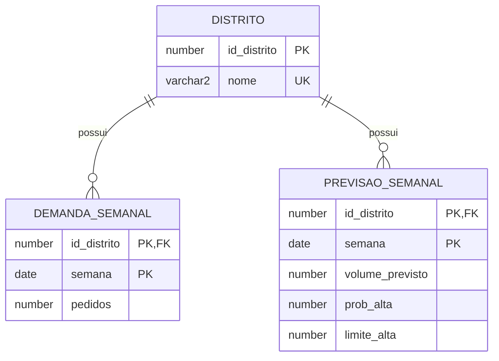

# VarreSP: API REST (Domain Driven Design - Java)

## Ficha da CitizenTech

| Campo | Projeto |
|---|---|
| Nome da CitizenTech | VarreSP |
| Equipe | Observatório de Bairro |
| Cidade e bairro | São Paulo (SP), com a Lapa como caso de leitura e os 96 distritos como universo de comparação |
| Cidadão beneficiado | Morador ou pedestre exposto à falta de varrição |
| Problema, em uma frase | Como direcionar vistorias semanais dispondo de três vagas e apenas do histórico de pedidos? |
| Como funciona | A solução agrega as reclamações do SP156, estima o volume e a probabilidade de alta e compara filas de prioridade em dados históricos. |
| O que cada parte faz | Ciência de Dados: prepara o histórico e estima volume e probabilidade. Banco de Dados: modela distritos, demandas e previsões semanais. Programação Dinâmica: monta o plano de vistorias de várias semanas. Java (este repositório): API REST que guarda esses dados no Oracle e entrega a fila de prioridade da semana. |
| Link do repositório | A preencher após publicar |
| Indicador de impacto | Acertos nas vagas de vistoria e cobertura territorial. No piloto, medir o tempo entre falha confirmada e correção. |
| ODS conectados | ODS 11, cidades e comunidades sustentáveis, com foco na gestão dos serviços urbanos; ODS 16, instituições eficazes, pela possibilidade de auditar os critérios de priorização. |

## Integrantes

| Nome | RM |
|---|---|
| Bruno Lisboa Rezende | 562228 |
| Fernando Kenzo Sassaki Cunha | 562343 |
| Marcello Lassalla de Mello Castanho e Oliveira | 561879 |
| Rafael Ali Oliveira Khalil | 561240 |

## Link do deploy

A preencher após o deploy no Render.

## O que a API faz

Guarda, por distrito e por semana, os pedidos registrados (demanda) e as previsões do modelo (volume previsto, probabilidade de alta e limite que define a alta). A partir das previsões, entrega a fila de prioridade da semana: os distritos com maior probabilidade de alta demanda, limitados ao número de vagas de vistoria. Distritos sem previsão na semana não entram na fila.

## Tecnologias e versões

| Item | Versão |
|---|---|
| Java (JDK) | 21 |
| Spring Boot | 3.5.16 |
| Maven | 3.9 ou superior |
| Banco de dados | Oracle (servidor da FIAP), driver `ojdbc11` |
| Deploy | Render (Docker) |

Os testes automatizados usam H2 em memória e não precisam do Oracle.

## Arquitetura

```
controller  recebe a requisição HTTP e valida o corpo
bo          regras de negócio e transações
dao         acesso ao banco (Spring Data JPA)
model       entidades JPA mapeadas para as tabelas Oracle
dto         objetos de entrada e saída da API
exception   exceções de negócio e tratamento global das respostas de erro
```

Regras de negócio:

- o nome do distrito é guardado em maiúsculas e é único;
- o identificador do distrito é o maior existente mais um, até o limite de 999 (`NUMBER(3)`);
- a semana é sempre a segunda-feira que a inicia, como exige o `CHECK` do banco;
- existe uma demanda e uma previsão por distrito e semana, que formam a chave primária;
- a probabilidade de alta fica entre 0 e 1 e o limite de alta é maior que zero;
- um distrito com demandas ou previsões não pode ser removido.

## Endpoints

| Método | Rota | Descrição | Sucesso |
|---|---|---|---|
| GET | `/api/distritos` | lista os distritos | 200 |
| GET | `/api/distritos/{id}` | busca um distrito | 200 |
| POST | `/api/distritos` | cria um distrito | 201 |
| PUT | `/api/distritos/{id}` | atualiza um distrito | 200 |
| DELETE | `/api/distritos/{id}` | remove um distrito | 204 |
| GET | `/api/demandas?distritoId=` | lista demandas, com filtro opcional | 200 |
| GET | `/api/demandas/{distritoId}/{semana}` | busca uma demanda | 200 |
| POST | `/api/demandas` | cria uma demanda | 201 |
| PUT | `/api/demandas/{distritoId}/{semana}` | atualiza os pedidos | 200 |
| DELETE | `/api/demandas/{distritoId}/{semana}` | remove uma demanda | 204 |
| GET | `/api/previsoes?semana=` | lista previsões, com filtro opcional | 200 |
| GET | `/api/previsoes/{distritoId}/{semana}` | busca uma previsão | 200 |
| POST | `/api/previsoes` | cria uma previsão | 201 |
| PUT | `/api/previsoes/{distritoId}/{semana}` | atualiza uma previsão | 200 |
| DELETE | `/api/previsoes/{distritoId}/{semana}` | remove uma previsão | 204 |
| GET | `/api/prioridades?semana=&vagas=3` | fila de prioridade da semana | 200 |
| GET | `/api/saude` | verificação de saúde do serviço | 200 |

A `semana` nas rotas e nos filtros usa o formato `AAAA-MM-DD`.

Erros seguem o formato:

```json
{
  "timestamp": "2026-11-18T14:00:00Z",
  "status": 400,
  "erro": "Bad Request",
  "mensagem": "Dados inválidos",
  "campos": { "pedidos": "O número de pedidos não pode ser negativo" }
}
```

| Status | Quando |
|---|---|
| 400 | corpo inválido, parâmetro inválido ou semana que não é segunda-feira |
| 404 | distrito, demanda, previsão ou rota inexistente |
| 405 | método HTTP não suportado na rota |
| 409 | nome de distrito repetido, demanda ou previsão repetida, ou remoção de distrito com dados |
| 500 | erro interno |

Exemplos de corpo:

```json
{ "nome": "LAPA" }
```

```json
{ "distritoId": 3, "semana": "2025-12-29", "pedidos": 42 }
```

```json
{ "distritoId": 3, "semana": "2025-12-29", "volumePrevisto": 38.5, "probAlta": 0.82, "limiteAlta": 7 }
```

O `PUT` de demanda recebe só `{ "pedidos": 42 }` e o de previsão recebe `volumePrevisto`, `probAlta` e `limiteAlta`, porque o distrito e a semana vêm da rota.

Resposta da fila de prioridade:

```json
[
  { "posicao": 1, "distritoId": 3, "distrito": "LAPA", "probAlta": 1, "volumePrevisto": 76.051 },
  { "posicao": 2, "distritoId": 2, "distrito": "JABAQUARA", "probAlta": 0.999935, "volumePrevisto": 27.265 }
]
```

A fila é ordenada por probabilidade de alta, depois por volume previsto e depois pelo identificador do distrito.

## Modelo de dados

As tabelas vêm do script `database/01_DDL.SQL`, mantido pela equipe de Banco de Dados.



## Como executar

1. Tenha o JDK 21 e o Maven instalados.
2. No Oracle, execute `database/01_DDL.SQL` e depois `database/02_DML.SQL` (carga de exemplo) em um esquema vazio.
3. Defina as variáveis de ambiente com o usuário e a senha do Oracle da FIAP. O usuário precisa ser o dono das tabelas, ou seja, o mesmo que executou o DDL.

```
export DB_USER=seu_usuario
export DB_PASSWORD=sua_senha
```

4. Rode a aplicação:

```
mvn spring-boot:run
```

A API sobe em `http://localhost:8080`. Teste em `http://localhost:8080/api/saude` e em `http://localhost:8080/api/prioridades?semana=2025-12-22`.

Variáveis de ambiente:

| Variável | Padrão | Uso |
|---|---|---|
| `DB_USER` | sem padrão | usuário do Oracle |
| `DB_PASSWORD` | sem padrão | senha do Oracle |
| `DB_URL` | `jdbc:oracle:thin:@oracle.fiap.com.br:1521:ORCL` | URL JDBC |
| `DB_POOL_SIZE` | 3 | conexões simultâneas com o banco |
| `DDL_AUTO` | `none` | `none` nunca altera o esquema; `validate` confere as tabelas na subida |
| `PORT` | 8080 | porta HTTP |

Testes:

```
mvn test
```

## Deploy no Render

O repositório tem um `Dockerfile` e um `render.yaml`.

1. Publique o repositório no GitHub.
2. No Render, crie um novo Blueprint apontando para o repositório, ou um Web Service com ambiente Docker.
3. Informe `DB_USER` e `DB_PASSWORD` quando o Render pedir. Não grave esses valores no repositório.
4. Aguarde o build. O serviço fica disponível em `https://<nome-do-servico>.onrender.com`, e `/api/saude` deve responder `{"status":"ok"}`.

O Render define a variável `PORT`, que a aplicação já lê.

Para testar a imagem localmente:

```
docker build -t varresp-api .
docker run --rm -p 8080:8080 -e DB_USER=seu_usuario -e DB_PASSWORD=sua_senha varresp-api
```
